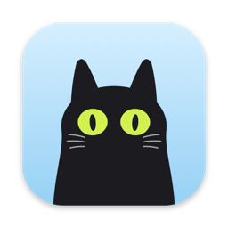

  

<h1 align="center">Whisku</h1>

  A tiny desktop cat that types, scrolls and naps along with you. For Mac and Windows. 
  Its name is <b>Whisku</b> (WHIS-koo), like the app.

  <b>English</b> | <a href="README.zh-CN.md">简体中文</a>

  
  
  

  <a href="https://github.com/whisku-app/whisku/releases/latest/download/Whisku-macOS-universal.zip"><b>Download for Mac</b></a> (macOS 13 or later, Apple Silicon and Intel)
  &nbsp;·&nbsp;
  <a href="https://github.com/whisku-app/whisku/releases/latest/download/Whisku-Windows-x64.exe"><b>Download for Windows</b></a> (Windows 10 or 11, 64-bit)

## What it does

- **Types with you.** Whisku sits at a little keyboard and presses keys on the same side you do, moves the mouse when you do, and strokes the scroll wheel while you scroll. It keeps up in games too, including held keys like WASD.
- **Cat Link.** See a faraway friend's cat on your screen, typing along with them, and pet each other's cats. Macs and Windows PCs can link. It's encrypted, and it never sends which keys you press.
- **Break reminder.** After an hour of work (or 30 minutes to 3 hours, your choice), Whisku waves and suggests a break.
- **Claude Code alerts.** A bubble over the cat when a [Claude Code](https://claude.com/claude-code) session finishes or needs your OK.
- **Little details.** Petting makes Whisku close its eyes, fast mouse movements turn on big "hunting" eyes, it puts on AirPods when you switch to headphones, and it naps when you're away (sometimes a mosquito wakes it).
- **Make it yours.** Four coats, three keyboard themes, six eye colors and five sizes. English or Chinese.
- **Small and native.** About 1 MB, no Electron: Swift on Mac, C++ on Windows. It updates itself from this repository's releases.

The four coats

| Classic black (Whisku) | Siamese |
| :---: | :---: |
|  |  |

| American Shorthair | Orange & white |
| :---: | :---: |
|  |  |

## Install

### Mac

1. Download **Whisku-macOS-universal.zip**, unzip it, and move **Whisku** into **Applications**. It lives in the menu bar (no Dock icon).
2. The first time you open it, macOS says it can't check the app, because Whisku isn't notarized by Apple yet. Open **System Settings → Privacy & Security**, scroll down, and click **Open Anyway** next to Whisku.
3. Click the **Allow keyboard access** pill under the cat, turn on **Whisku** under **Input Monitoring**, then choose **Restart Whisku** from the cat's menu.

### Windows

1. Download **Whisku-Windows-x64.exe** and run it. It's a single file; there's nothing to install.
2. If Windows says **Windows protected your PC**, click **More info → Run anyway**. The exe isn't code-signed yet.
3. Whisku lives in the system tray (in the **^** area of the taskbar). Right-click the cat or its tray icon for the menu.

**Using Whiskerkey?** That was Whisku's name until v1.0.2. It updates itself to Whisku and keeps your settings, Cat Link and keyboard permission.

**Moving from KuroCat?** Install Whisku once by hand. On its first launch it brings over your settings, cats and Cat Link pairing code, and quits KuroCat. Details are in the [changelog](CHANGELOG.en.md).

## How to use

Right-click the cat, or click its icon in the menu bar or the tray, for the menu.

- **Cat Link**: choose **🔗 Cat Link → Create a pairing code to invite a friend…** and send the code to your friend. They choose **Enter a friend's pairing code…** in the same menu (on Windows: copy the code, then click **Paste a friend's pairing code and link**). **⏸ Pause sharing my cat** hides your cat from your friend without disconnecting. **🎬 Demo: pretend friend** shows what it looks like, without sending anything.
- **Break reminder**: **Break reminder ☕** sets how long you work before Whisku reminds you, and **Preview the reminder** shows it right away. Click **OK** and step away for 2 minutes (you get 30 seconds to save your work first), or **Later** to be reminded again in 30 minutes. 15 minutes without the mouse or keyboard, or 2 minutes with the screen locked or the computer asleep, also counts as a break.
- **Claude Code alerts**: choose **Claude Code alerts 🤖 → Copy Claude Code hook settings**, merge what it copies into `~/.claude/settings.json` (Windows: `%USERPROFILE%\.claude\settings.json`), then reopen Claude Code.
- **Updates**: Whisku checks at launch and every 6 hours, and asks before installing. **Check for updates** in the menu checks right away.
- **Language**: the menus follow your system language. **语言 / Language** in the menu changes it.

## Privacy

Whisku sees every key you press, so here is exactly what it does with that.

- **What it reads.** Key presses, mouse movement, clicks and scrolling, only to move the cat. It never records which keys you type. On Mac it also saves two numbers: today's keystroke count, and how many times you've petted the cat. On Windows, the keystroke count is kept only while the app runs.
- **What it stores.** Your settings and your Cat Link pairing code and nickname (plus those two numbers on Mac), only on your computer: in `~/Library/Preferences/com.whiskerkey.app.plist` on Mac, and under `HKEY_CURRENT_USER\Software\Whiskerkey` in the Windows registry. (Whiskerkey is Whisku's old name; these places keep it so your settings stay put.)
- **No tracking.** No analytics, no accounts, no ads.
- **When it goes online:**
  - **Update checks.** It asks GitHub for this repository's latest release, and downloads it only after you agree to update.
  - **Cat Link, only after you turn it on.** It connects to EMQX's free public relay server (broker-cn.emqx.io in Shanghai, or broker.emqx.io in the US) and sends:
    - which paw is typing (left or right, never the key)
    - mouse position and speed, clicks, scrolling and petting
    - your cat's nickname and colors, and whether headphones are on

    Everything is encrypted with your pairing code, so the relay only sees scrambled data, plus your IP address and the times you send. While a password field is active, no typing activity is sent at all. **⏸ Pause sharing my cat** sends nothing but a "paused" signal, and turning Cat Link off stops everything. The details are in [docs/cat-link-protocol.md](docs/cat-link-protocol.md).
  - **Claude Code alerts and the break reminder** never leave your computer.
- **Permissions.** On Mac, Input Monitoring, so the cat can see the keyboard while you work in other apps. On Windows, the standard way to read raw keyboard and mouse input. It doesn't need administrator rights, except to see keys in games that themselves run as administrator. To stop sending typing activity during passwords, the Windows version checks whether the active text box is a password field, but never reads what's in it.
- **Removing everything.** First turn off **Start at login** (Mac) or **Start with Windows** in the menu, and quit Whisku.
  - **Mac:** delete the app, then run `defaults delete com.whiskerkey.app` in Terminal.
  - **Windows:** delete the exe, then run `reg delete HKCU\Software\Whiskerkey /f` in Command Prompt.
- **Check it yourself.** All the code is in this repository.

## Troubleshooting

- **Windows: the cat follows the mouse but not the keyboard in a game.** The game (or its launcher) runs as administrator, and Windows keeps its keystrokes from normal apps. Right-click the cat → **Restart as administrator**, or tick **Always run as administrator**. Whisku shows a tray tip when it notices such a game.
- **Windows: the cat disappears in a game.** Exclusive fullscreen can't be covered by any desktop window. Switch the game to borderless or windowed fullscreen.
- **Clicks go through the cat, and I can't reach its menu.** That's **Full click-through**. On Windows, press **Ctrl + Alt + Shift + P**, hold **Alt** while right-clicking the cat, use the tray icon, or open `Whisku.exe` again. On Mac, hold **⌥ Option** while right-clicking the cat, or use the menu bar icon.
- **Mac: the cat doesn't react to the keyboard.** Check that **Whisku** is on under **System Settings → Privacy & Security → Input Monitoring**, then choose **Restart Whisku** from the cat's menu.

## Build from source

- **Mac:** `./build.sh`, then `open Whisku.app`. To keep the Input Monitoring permission across rebuilds, first run `bash scripts/create-macos-signing-cert.sh` once. It creates a free self-signed signing certificate in your login keychain, with a private backup in `~/Whiskerkey-signing`. Never upload that backup.
- **Windows:** `cd windows`, then `build.bat` (MSVC or MinGW), or `cmake -B build && cmake --build build --config Release`.
- **More:**
  - how releases are made: [docs/releasing.md](docs/releasing.md)
  - Cat Link's wire format: [docs/cat-link-protocol.md](docs/cat-link-protocol.md)
  - the icons: `scripts/make-icons.sh` draws them from the app's own cat
  - what changed in each version: the [changelog](CHANGELOG.en.md)

## Credits and license

Whisku started from [KuroCat](https://github.com/chanke17/KuroCat) v1.3.3 by chanke17, with the Shorthair and Orange & white coats by andyforfun168. It was called KuroCat until v1.3.3-mmccqq.8, and Whiskerkey until v1.0.2. Upstream KuroCat also has a Linux version; the `linux/` folder here is upstream's code, unchanged.

This project is licensed under the [GNU General Public License v3.0](LICENSE). Everything added or changed after KuroCat v1.3.3, in every version from v1.3.3-mmccqq.1 on, is Copyright (C) 2026 mmccqq. The code it started from is MIT-licensed and keeps its [MIT notice](LICENSE-MIT), which covers only that code.
