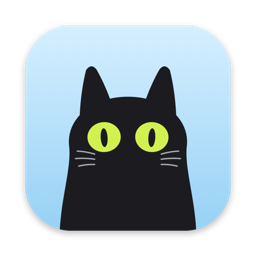

  

<h1 align="center">Whiskerkey</h1>

  一只陪你打字、滚动、打盹的桌面小黑猫，支持 Mac 和 Windows。 
  它叫 <b>Whisku</b>（读作 WHIS-koo）。

  <a href="README.md">English</a> | <b>简体中文</b>

  
  
  

  <a href="https://github.com/whiskerkey/whiskerkey/releases/latest/download/Whiskerkey-macOS-universal.zip"><b>下载 Mac 版</b></a>（macOS 13 及以上，Apple 芯片和 Intel 都支持）
  &nbsp;·&nbsp;
  <a href="https://github.com/whiskerkey/whiskerkey/releases/latest/download/Whiskerkey-Windows-x64.exe"><b>下载 Windows 版</b></a>（Windows 10 或 11，64 位）

## 它能做什么

- **陪你打字**：Whisku 坐在小键盘前，你按哪一侧的键，它就按同一侧；你动鼠标它也动，你滚动时它的爪子拨滚轮。玩游戏也跟得上，长按 WASD 这样的按键也没问题。
- **猫咪连线**：在你的屏幕上看到异地朋友的猫，跟着朋友一起打字，还能隔空互相摸猫。Mac 和 Windows 可以互连。内容加密，从不发送按了哪个键。
- **休息提醒**：连续工作 1 小时（可选 30 分钟到 3 小时）后，Whisku 招手提醒你休息一下。
- **Claude Code 提醒**：[Claude Code](https://claude.com/claude-code) 的会话完成或等你确认时，小猫头上弹出气泡。
- **小细节**：摸它会闭眼；快速晃鼠标会出现捕猎大圆眼；切到耳机时会戴上 AirPods；你离开时它会打盹（有时会有蚊子来吵醒它）。
- **按你的喜好**：4 款猫咪皮肤、3 种键盘配色、6 种瞳色、5 档大小，中文或英文界面。
- **小巧原生**：大约 1 MB，不用 Electron：Mac 版用 Swift，Windows 版用 C++。从本仓库的发布页自动更新。

四款猫咪皮肤

| 经典小黑猫（Whisku） | 暹罗猫 |
| :---: | :---: |
|  |  |

| 美短 | 橘白猫 |
| :---: | :---: |
|  |  |

## 安装

### Mac

1. 下载 **Whiskerkey-macOS-universal.zip**，解压后把 **Whiskerkey** 拖进「应用程序」。它常驻在顶部菜单栏，不占 Dock。
2. 第一次打开时，macOS 会提示无法验证这个程序，因为 Whiskerkey 还没有经过 Apple 公证。打开 **系统设置 → 隐私与安全性**，往下滚动，在 Whiskerkey 旁边点 **仍要打开**。
3. 点小猫下方的「点击开启全局/游戏键盘监听 🔑」，在 **输入监控** 里打开 **Whiskerkey**，然后在小猫的菜单里选「重启 Whiskerkey」。

### Windows

1. 下载 **Whiskerkey-Windows-x64.exe** 直接运行。只有一个文件，不用安装。
2. 如果 Windows 提示「Windows 已保护你的电脑」，点 **更多信息 → 仍要运行**。这个 exe 暂时还没有代码签名。
3. Whiskerkey 常驻在系统托盘（任务栏右下角的 **^** 里）。右键小猫或托盘图标打开菜单。

**从 KuroCat 换过来？** 手动安装一次 Whiskerkey。第一次打开时，它会带上你的设置、小猫和猫咪连线配对码，并关掉 KuroCat。详见[更新记录](CHANGELOG.md)。

## 怎么用

右键小猫，或者点菜单栏/托盘里的小猫图标，打开菜单。

- **猫咪连线**：选「🔗 猫咪连线」→「创建配对码，邀请朋友…」，把配对码发给朋友。朋友在同一个菜单里选「输入朋友的配对码…」（Windows：复制配对码后点「粘贴朋友的配对码并连线」）。「⏸ 暂停分享我的猫」可以不断开连线，只让朋友看不到你的猫。「🎬 演示：模拟一位朋友」可以先看看效果，不会发送任何内容。
- **休息提醒**：「休息提醒 ☕」里选择工作多久后提醒，「预览提醒」可以立刻看效果。点「好的」后离开 2 分钟就算休息（先给你 30 秒保存工作），点「等会儿」30 分钟后再提醒。15 分钟没碰鼠标和键盘，或者锁屏、电脑睡眠 2 分钟，也算休息。
- **Claude Code 提醒**：选「Claude Code 提醒 🤖」→「复制 Claude Code 钩子设置」，把复制的内容合并到 `~/.claude/settings.json`（Windows：`%USERPROFILE%\.claude\settings.json`），然后重新打开 Claude Code。
- **更新**：Whiskerkey 启动时和之后每 6 小时检查一次，安装前会先问你。菜单里的「检查更新」可以立刻检查。
- **语言**：菜单默认跟随系统语言，可以在菜单「语言 / Language」里切换。

## 隐私

Whiskerkey 能看到你按的每一个键，所以这里写清楚它怎么处理这些信息。

- **它读取什么**：按键、鼠标移动、点击和滚动，只用来让小猫动起来。它从不记录你按了哪些键。Mac 版还会保存两个数字：今天的按键次数，以及你摸过小猫多少次；Windows 版的按键次数只在程序运行时记着，不保存。
- **它保存什么**：你的设置、猫咪连线配对码和昵称（Mac 版还有上面那两个数字），只保存在你的电脑上：Mac 上在 `~/Library/Preferences/com.whiskerkey.app.plist`，Windows 上在注册表的 `HKEY_CURRENT_USER\Software\Whiskerkey` 里。
- **没有任何追踪**：没有统计分析，没有账号，没有广告。
- **什么时候联网**：
  - **检查更新**：向 GitHub 查询本仓库的最新版本，只有你同意更新后才会下载。
  - **猫咪连线，只在你打开之后**：连接 EMQX 的免费公共中转服务器（上海的 broker-cn.emqx.io 或美国的 broker.emqx.io），发送：
    - 哪只爪子在打字（左或右，从不发送按了哪个键）
    - 鼠标位置和速度、点击、滚动、摸猫
    - 小猫的昵称和配色，以及是否戴着耳机

    所有内容都用配对码加密，中转服务器只能看到加密后的数据，以及你的 IP 地址和发送时间。正在输入密码时，完全不发送打字动作。「⏸ 暂停分享我的猫」期间只发送一个「已暂停」信号，关掉猫咪连线后什么都不发送。细节见 [docs/cat-link-protocol.md](docs/cat-link-protocol.md)。
  - **Claude Code 提醒和休息提醒**从不离开你的电脑。
- **需要的权限**：Mac 上需要「输入监控」，这样你在其他程序里打字时小猫也能看到键盘。Windows 上用系统标准的方式读取键盘和鼠标的原始输入，不需要管理员权限；只有当游戏本身以管理员身份运行时，才需要管理员权限才能看到它的按键。为了在输入密码时停止发送打字动作，Windows 版会检查当前的输入框是不是密码框，但从不读取里面的内容。
- **彻底删除**：先在菜单里关掉「开机自动启动」，再退出 Whiskerkey。
  - **Mac**：删除程序，然后在「终端」里运行 `defaults delete com.whiskerkey.app`。
  - **Windows**：删除 exe，然后在「命令提示符」里运行 `reg delete HKCU\Software\Whiskerkey /f`。
- **自己检查**：全部代码都在这个仓库里。

## 常见问题

- **Windows：游戏里小猫只跟鼠标、不跟键盘？** 这个游戏（或它的启动器）以管理员身份运行，Windows 不让普通程序看到它的按键。右键小猫 →「以管理员身份重新启动」，或者勾选「每次启动都以管理员身份运行」。Whiskerkey 发现这种游戏时，也会在托盘弹出提示。
- **Windows：进游戏后小猫消失？** 「独占全屏」时任何桌面窗口都盖不上去。请在游戏设置里改成「无边框窗口」或「窗口化全屏」。
- **点击会穿过小猫，打不开它的菜单？** 这是开启了「完全鼠标穿透」。Windows 上按 **Ctrl + Alt + Shift + P**，或按住 **Alt** 再右键小猫，或用托盘图标，或再打开一次 `Whiskerkey.exe`。Mac 上按住 **⌥ Option** 再右键小猫，或用菜单栏图标。
- **Mac：小猫对键盘没反应？** 检查 **系统设置 → 隐私与安全性 → 输入监控** 里的 **Whiskerkey** 是否已打开，然后在小猫的菜单里选「重启 Whiskerkey」。

## 从源码构建

- **Mac**：运行 `./build.sh`，然后 `open Whiskerkey.app`。想让「输入监控」权限在重新构建后保留，请先运行一次 `bash scripts/create-macos-signing-cert.sh`。它会在「登录」钥匙串里创建一张免费的自签名签名证书，备份在 `~/Whiskerkey-signing`。不要上传这份备份。
- **Windows**：`cd windows`，然后运行 `build.bat`（MSVC 或 MinGW），或者 `cmake -B build && cmake --build build --config Release`。
- **更多**：
  - 发布流程：[docs/releasing.md](docs/releasing.md)
  - 猫咪连线的协议：[docs/cat-link-protocol.md](docs/cat-link-protocol.md)
  - 图标：`scripts/make-icons.sh` 根据程序里画的小猫生成
  - 每个版本的改动：[更新记录](CHANGELOG.md)

## 致谢与许可证

Whiskerkey 基于 chanke17 的 [KuroCat](https://github.com/chanke17/KuroCat) v1.3.3，其中美短和橘白猫两款皮肤由 andyforfun168 制作。v1.3.3-mmccqq.8 之前它叫 KuroCat。上游 KuroCat 还有 Linux 版；这里的 `linux/` 文件夹是上游原样的代码。

本项目采用 [GNU 通用公共许可证 v3.0（GPL-3.0）](LICENSE)。KuroCat v1.3.3 之后新增或修改的全部内容（从 v1.3.3-mmccqq.1 起的每个版本），版权归 mmccqq 所有（Copyright (C) 2026 mmccqq）。项目最初基于的代码采用 MIT 许可证，保留其 [MIT 声明](LICENSE-MIT)，MIT 许可证只适用于这部分代码。
